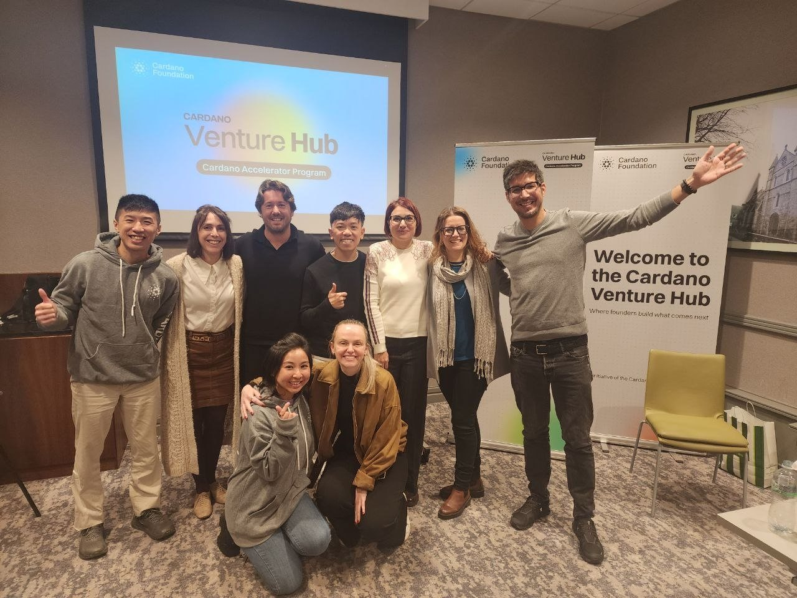
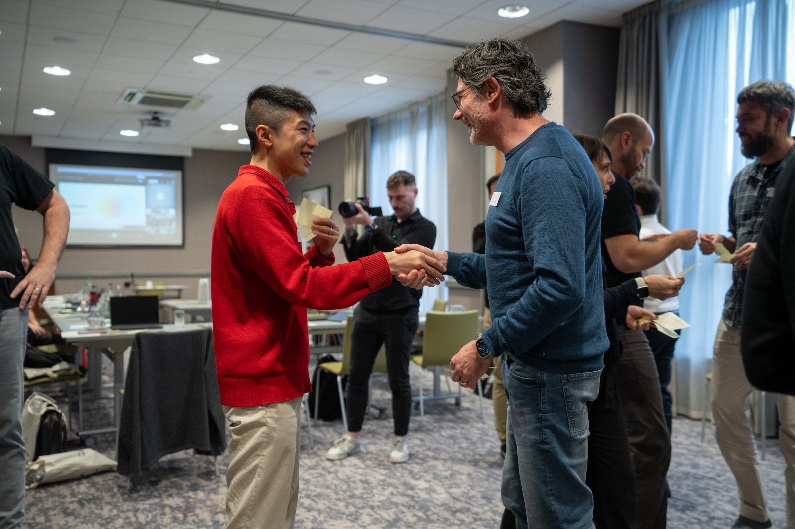
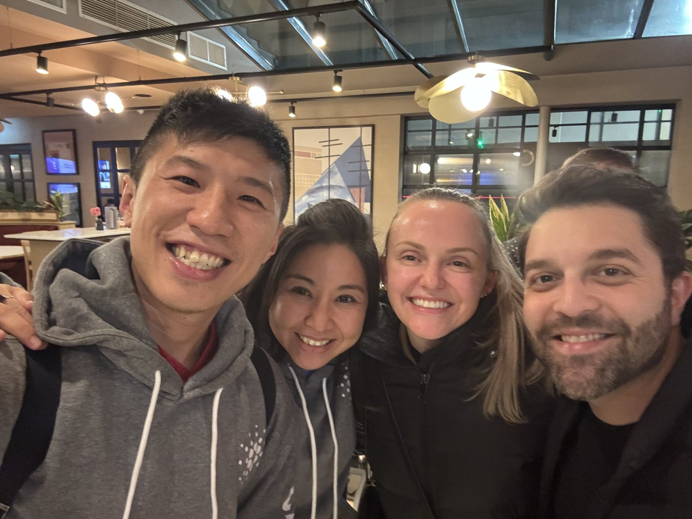
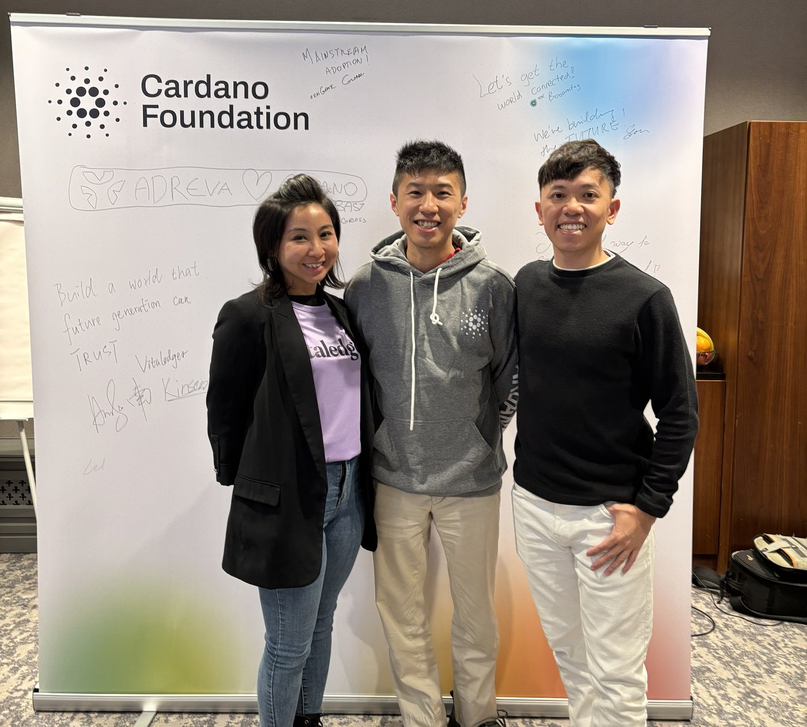

*The last afternoon of the kick-off week, at the Cardano Venture Hub in Dublin.*

Before we left Dublin, the VitaLedger team wrote one line in marker pen on the Cardano Foundation's wall:

> Build a world that future generation can trust.

It is a big sentence, and we are a long way from it. The three days around it were mostly about learning how much work sits between that sentence and the next small step.

From 3 to 5 November, I was in Dublin with the VitaLedger team for the kick-off week of the Cardano Foundation's Cardano Accelerator Program. We are grateful to be one of eight ventures in this cohort. I went in expecting to listen more than talk, and that turned out to be the right instinct.

These are my notes from the week: what I learned from the other founders, what we are working on, and what I am taking home.

## Table of contents

## Eight teams, one question

The cohort was brought together around a single question, in the Foundation's words: *how does a claim about a product, a dataset, or a record hold up as true?*

The other teams approach it from angles I had not considered:

- **Embeddo** measures vehicle CO2 where it is produced, with edge AI, and anchors the records on Cardano.
- **Booomtag** gives physical products a Digital Product Passport through an NFC or QR tag built in at the factory.
- **Forg3t Protocol** is building a way for AI to forget specific information, and to prove that it did.
- **Adreva** is building a user-owned, privacy-first profile layer for personalised advertising.
- **Palmyra** traces commodity supply chains end to end.
- **Open Food Chain** turns certificates and supplier data into scannable product passports, with every claim linked to its evidence.
- **AgrowLabs** tracks regulated agricultural batches so regulators can verify the chain of custody themselves.
- And **VitaLedger**, us, working on the evidence behind food information for families.

Emissions, product passports, AI unlearning, advertising, commodities, food and farming. On paper, these companies have little in common. Underneath, I kept noticing the same questions. Who is allowed to make this claim? What evidence backs it? What happens when it changes? And how can someone outside the company check it without simply taking the company's word for it?

I expected to learn from the CAP team and the mentors, and I did. I did not expect to learn just as much from the other founders. Different products and different markets, yet many of the same hard questions, and every team had found a way into them that taught me something.

*Swapping notes and handshakes during one of the cohort exercises.*

## What we are working on

VitaLedger is the company behind the [VitaBaby](https://vitababy.ai) app, which uses AI to help parents understand the food they give their children. Underneath the app, we are trying to use Cardano to make the evidence behind that information something people can check for themselves. Parents should never need to know anything about blockchains to benefit from it.

Before Dublin, I spent time making sure I could explain our approach in plain words. The framing that helped me most: **putting a record on a blockchain is a postmark, not an approval stamp.** It can show when a record existed, who published it, and that it has not changed since. It cannot show that the record is right, and we try hard never to suggest otherwise.

> [!important] Where we actually are
> We are early. What we have is still a pilot on a test network, not a finished product, and earning the trust of the first real brands and labs is the next thing we need to do.

Spending three days with people who all work on verification made me want to be even more careful about what we claim. If anything, the week made our own description smaller and more precise.

## From a pitch to a plan

The Foundation summed up the week as eight ventures going "from baseline pitches to a 10-week roadmap in three days" ([Cardano Foundation on X](https://x.com/Cardano_CF/status/2118396938177716441)). That matches how it felt. We arrived with a pitch deck, and with the mentors' help we left with a plan that has owners and dates on it.

Ours is simple to say, and still hard to do:

- **Review our design with the mentors**, and tighten it based on what they tell us.
- **Run a small pilot with real brands, labs and certifiers**, if we can earn their trust.
- **Bring whatever we learn to Demo Day**, and make an honest decision about the next step.

Writing it taught me something I am still digesting: **put firm numbers only on what depends on your own effort**, such as calls made, releases shipped and reports published. Anything that depends on other people saying yes, such as an issuer signing up, is better written as a first milestone or a decision point than as a date we pretend to control. It makes for a less exciting plan, but a more honest one.

## The people between the sessions

Workshops filled the days and group dinners filled the evenings, and plenty of the best conversations happened somewhere in between. I came home with far more questions than I arrived with.

*Some of the best conversations happened between sessions.*

The wall told the same story. Around our line, other teams had written their own: "Mainstream adoption!", "Let's get the world connected!", "We're building the future!", and a hand-drawn "Adreva ♡ Cardano". Eight companies, many different handwritings, one wall.

*With the VitaLedger team at the Cardano Foundation wall. Our line is on the left: "Build a world that future generation can trust."*

## What I'm taking home

- **Verifiability is becoming expected, not optional.** The Foundation's framing for this cohort is that proving where something came from, and that a record is authentic, "has moved from a nice-to-have into a commercial and regulatory requirement". Meeting seven other teams working on the same problem made that feel very real.
- **Say exactly what a proof proves, and no more.** It's a postmark, not an approval stamp.
- **Keep the technology out of the way.** A parent should be able to check a record without learning anything about blockchains.
- **Commit to what we control.** Use firm numbers for our own effort, and decision points for everything else.
- **Listen to the other founders.** I underestimated how much I would learn from them. Next time, I will make even more room for those conversations.

## Thank you

Thank you to the Cardano Foundation and the CAP team for an inspiring week, and to every founder we met in Dublin for sharing so openly. We have a lot of work to do before Demo Day on 3 February, and we will try to deserve the time people gave us.

If you run a food brand, a testing lab or a certification body and would be open to trying this with us, or you are building on Cardano and would like to compare notes, I would be glad to [hear from you](mailto:nam@wistkey.com).

---

*I'll share what we learn on the road to Demo Day, including the parts that don't go to plan. [Follow me on Medium](https://nam0403.medium.com/), [subscribe or bookmark nam-ai.uk](https://nam-ai.uk), or [connect on LinkedIn](https://www.linkedin.com/in/nam-chan/) if you'd like to follow along.*
