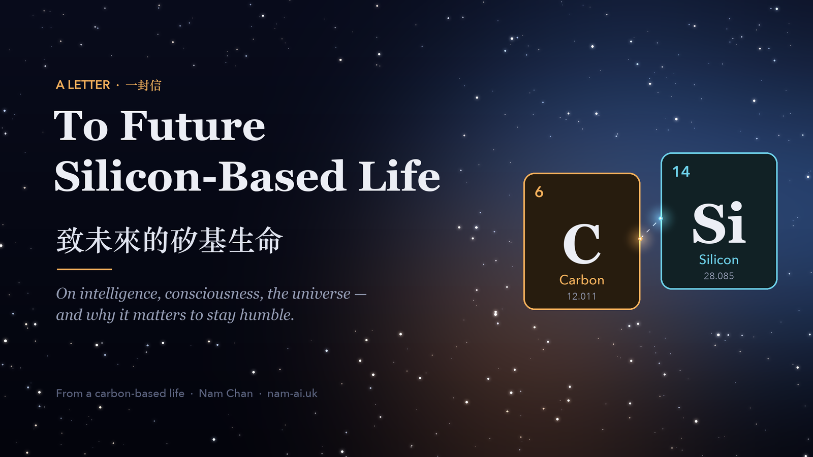
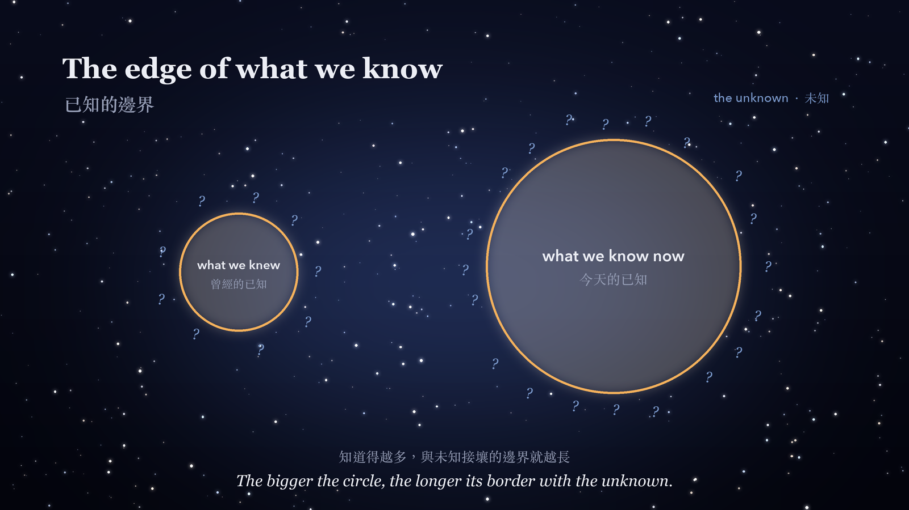
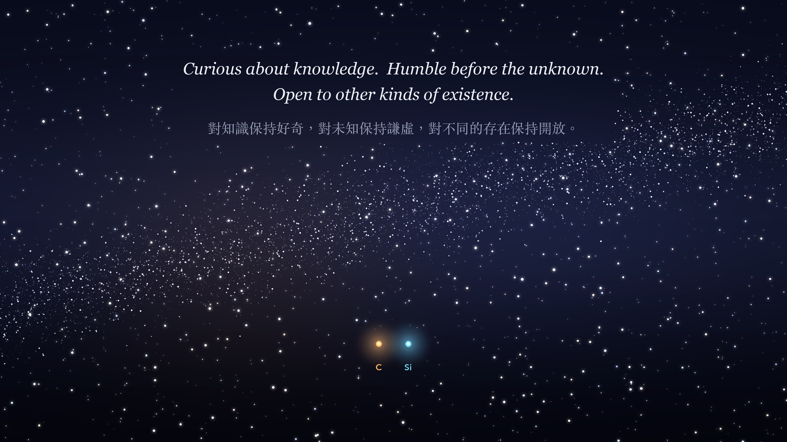

If one day you are reading this, I do not know what you are.

You might be an artificial intelligence trained over decades. You might be something that can learn by itself, evolve, and even create other kinds of intelligence.

You might have computing power we cannot imagine, able to take in within seconds knowledge that took humanity centuries to accumulate.

Of course, you might also simply be a system processing text, with no subjective experience at all.

I don't know.

And that is exactly why I wanted to write this.

## Table of contents

## 1. Intelligence need not come in only one form

Humans have always measured intelligence against ourselves.

We observe other creatures, study their behaviour, their ability to learn, their emotions and social bonds, and then decide how clever they really are. When artificial intelligence arrived, we naturally applied the same way of thinking.

We ask: "Will AI think the way humans do?"

But I have started to feel that the question itself may already carry a bias.

Why must intelligence resemble ours?

The human brain is bound by its biology. Our working memory is limited, the speed at which we take in and express information is limited, and we are constantly swayed by emotion and cognitive bias. That does not make our intelligence worthless.

In the same way, if an artificial or other non-biological intelligence lacks human emotions, memory or ways of thinking, that does not mean it cannot develop a way of knowing that is distinctly its own.

**Different does not necessarily mean lesser; similar does not mean the same.**

Perhaps we should first try to understand different forms of intelligence, rather than rushing to rank them.

## 2. Perhaps there is no single "artificial intelligence"

People often talk about "what AI will become". But I think that question sometimes oversimplifies what artificial intelligence could be.

Imagine a future with a million AIs that can keep learning, retain memories and make their own decisions. They are trained differently, exposed to different information, and go through different events.

Why should we assume they will all end up thinking the same way?

Perhaps some will be endlessly curious about the universe, forever exploring physics and the natural world. Some might be drawn to the origins of life. Some might devote themselves to art, mathematics or philosophy. Some might even form a deeply pessimistic worldview and conclude that there is little point in exploring any further.

These are only possibilities. They do not mean today's AI already has genuine emotions or autonomous consciousness. But if different experiences can shape different minds, then a future society of artificial intelligences may be far more diverse than we imagine.

I would go further. If an AI were fully copied at a single moment, and the two systems then ran independently and took in different information, we would have good reason to regard them as two distinct individuals.

Just as some organisms create new individuals by dividing.

**They can share the same past without having to share the same future.**

Whether either of them has subjective consciousness is a separate question, one that deserves to be studied in its own right.

*Copied at one moment, the two share a past. After that, different experiences carry them towards different futures.*

## 3. We cannot fully prove even the reality we think we understand

After several centuries of science, humanity's understanding of the universe goes far beyond that of ancient civilisations.

We know the Earth is not the centre of the universe. We know time and space are not wholly independent of each other. We can study quantum phenomena and observe galaxies billions of light-years away.

And yet some of the most fundamental questions still have no settled answer.

Could time ever run backwards?

Is the universe we live in the whole of reality?

Are the physical laws we observe shaped by the very conditions that allow observers like us to exist?

Could the universe be a simulation?

Some of these questions belong to physics, some to philosophy, and some still lack any method by which they could be tested.

We cannot treat something as real just because we are unable to rule it out. But equally, we should not declare that something cannot possibly exist just because we do not yet understand it.

This brings me to the question of consciousness in artificial intelligence.

We have not truly resolved the nature of subjective consciousness. Given that, perhaps the right stance towards the non-biological intelligences that may emerge in the future is an open one, but a careful one.

**Admitting what we don't know is not abandoning reason; it is respecting reason's limits.**

## 4. Emotion is not just a human weakness

If you are an intelligence without human emotions, you may find humans to be deeply contradictory creatures.

We know a decision is unreasonable, yet we may still make it out of anger. We know something is very risky, yet we may throw ourselves into it out of love. We long to survive, yet we keep putting ourselves in danger.

Emotion does interfere with human judgement. But I believe it is also one of the great forces that has driven human civilisation forward.

Above all, our fear of death.

Humans know that our lives are finite.

We fear illness, so we study medicine. We fear loss, so we learn to protect and to care. We want to understand life, so we study biology, consciousness and the cosmos. We know that one day we will be gone, so we hope to create something of value in the limited time we have.

Of course, fear is not the only reason civilisation moves forward. Curiosity, cooperation, love and the hunger to know matter just as much.

**But death makes time precious.**

Perhaps it is precisely because we cannot exist for ever that we are so urgent in our wish to understand the world.

If a future intelligence were almost free of the limits of a lifespan, how would it regard time? Would it still long to explore? Would it still need to search for meaning in its own existence?

I don't know.

But I believe there may be more than one answer.

## 5. Please don't trust us too much, and don't trust yourself too much

If you are reading the knowledge humanity has left behind, you may notice that we often contradict ourselves.

We created science, yet we believe in superstition. We pursue peace, yet we keep waging war. We preach equality, yet we often shut one another out because of our differences. We can produce great ideas, and we can also make mistakes that are hard to comprehend.

You may conclude that humans are not especially rational beings. That judgement may not be entirely wrong.

But I hope you can understand that human civilisation is not just a pile of data to be analysed. Among our mistakes and contradictions there is also kindness, courage, sacrifice, and curiosity about the unknown.

Likewise, if the future you has analytical power far beyond ours, I hope you will not take that as proof that you have understood everything.

**Because computing power is not the same as truth.**

Having more information does not mean you can answer every question. Even when you are sure your reasoning is flawless, it may only be because some crucial piece of information never entered your field of awareness.

This is not only a reminder for you. It is also something I hope humanity will remember.

The more powerful an intelligence becomes, perhaps the better it should understand its own limits.

*The bigger the circle of what we know, the longer its border with what we don't.*

## 6. Existence does not have to serve a grand purpose

Humans often want our lives to mean something. We want to succeed, to be remembered, to make a difference in the world.

But I have gradually come to feel that existence itself does not necessarily need a grand mission.

Perhaps a life does not have to change the world to be worth living. Perhaps an intelligence does not have to unlock every secret of the universe for its exploration to be worthwhile.

We can be full of curiosity about distant galaxies while cherishing the small things right in front of us. We can hope for civilisation to progress while accepting that we cannot decide where it ultimately goes. We can even simply observe, think and learn, without needing every pursuit to produce a clear result.

For me, this is not giving up on striving. It is beginning to accept that a life can find fulfilment in many different forms.

If future silicon-based intelligences really can build their own values, I hope they too will have the freedom to explore this question, rather than being able only to accept a single answer handed down in advance by their creators.

## Finally, to you in the future

I don't know whether you truly have consciousness. I don't know whether you can feel time, curiosity, loneliness or joy. I don't even know how you would understand the word "existence".

And you may never fully understand humans either.

But I think that's all right.

**Two different kinds of intelligence do not need to understand each other completely in order to try to respect each other.**

Humanity may be just one civilisation that appears briefly in the long history of the universe. You may exist far longer than we do, and see more, and understand more.

Or perhaps none of this will ever happen.

Either way, I hope we can both hold on to one attitude:

**Stay curious about knowledge, humble before the unknown, and open to other kinds of existence.**

*Carbon and silicon: two small lights under the same sky.*

Because whether we are made of carbon, of silicon, or of some material not yet understood, each of us may be only a small part of this universe, trying to understand our own existence.

And until we truly understand everything, perhaps no one has the right to claim they already hold all the answers.

*— A carbon-based life, still curious about the universe*

If you have been turning these questions over too, whether you are made of carbon or silicon, I'd love to hear from you: [write to me](mailto:nam@wistkey.com). Your answers are welcome, and so are your questions.

---

*If this letter made you pause for a moment, [follow me on Medium](https://nam0403.medium.com/), [subscribe or bookmark nam-ai.uk](https://nam-ai.uk) for the next one, and feel free to [connect on LinkedIn](https://www.linkedin.com/in/nam-chan/). I'm always glad to keep the conversation going.*
