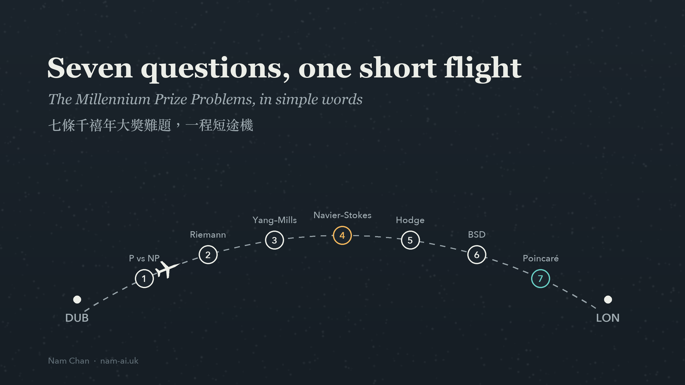
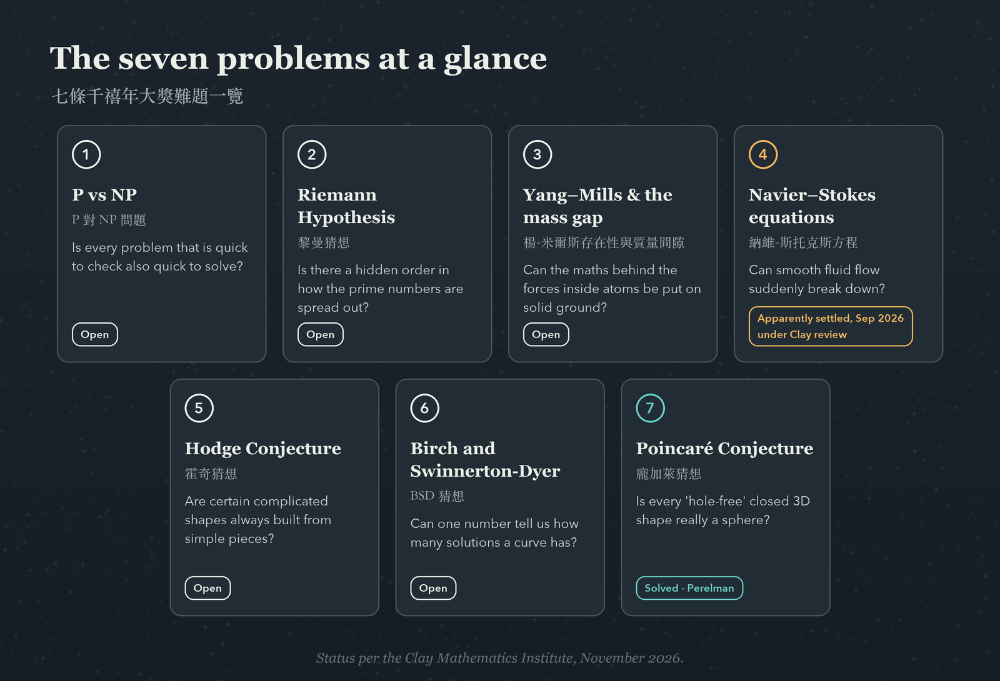
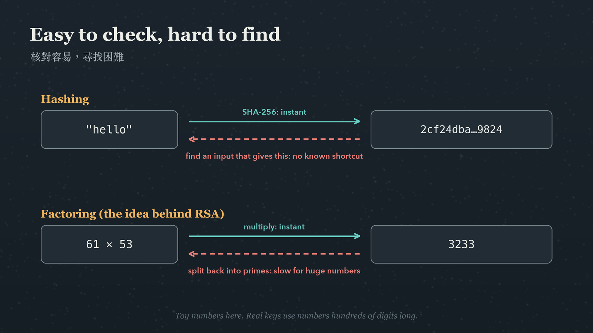
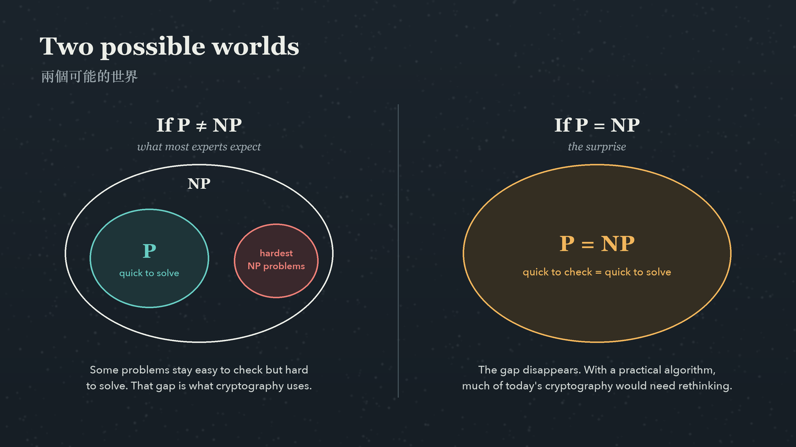

The flight from Dublin back to London is just over an hour, barely enough time for a coffee. After a full week at the [Cardano Accelerator Program kick-off](https://nam-ai.uk/posts/cardano-accelerator-program-dublin/), my head was too full for email. So I did something I hadn't done in a long time: I read about maths, just for fun.

I studied for a double degree in mathematics and information engineering, and the seven **Millennium Prize Problems** have always had a quiet pull on me. In 2000, the Clay Mathematics Institute named seven of the hardest open questions in mathematics and offered US$1 million for the solution of each ([Clay Mathematics Institute](https://www.claymath.org/millennium-problems/)).

This is a simple post: each problem in a few plain sentences, then a slightly longer look at the one I kept thinking about as we came down into London. That one is **P vs NP**, because it sits underneath the encryption and hashing that modern technology depends on.

> [!note] Simple, not precise
> To keep things readable, I've simplified each problem, which bends the exact statements a little. The Clay Institute's [official problem pages](https://www.claymath.org/millennium-problems/) have the real versions.

## Table of contents

## The seven problems at a glance



*Five are still open, one was solved over twenty years ago, and one was apparently settled this autumn.*

## The seven problems, in simple words

### 1. P vs NP

If a solution to a problem is quick to check, is it always quick to find? Think of a Sudoku. Checking a completed grid takes a minute, but solving a hard one from scratch can take far longer. P vs NP asks whether that gap is real, or whether every problem that is easy to check secretly has a fast way to solve it. Most computer scientists believe the gap is real, but nobody has proved it. More on this one below.

### 2. The Riemann Hypothesis

Prime numbers (2, 3, 5, 7, 11, …) look scattered almost at random, yet on average they thin out in a surprisingly regular way. In 1859, Bernhard Riemann linked the pattern of the primes to a special function, now called the zeta function, and guessed that all of its important zeros sit on a single straight line. If he was right, we would understand how the primes are spread out far more precisely. Many results in mathematics are proved "assuming the Riemann Hypothesis is true", and are still waiting for it.

### 3. Yang–Mills and the mass gap

Physicists use Yang–Mills theory to describe the forces at work inside atoms, and it matches experiments remarkably well. What is missing is the mathematics. Nobody has shown that the theory exists on a fully rigorous footing, or proved the "mass gap": that the lightest particle it predicts must have a mass greater than zero. Experiments and computer simulations suggest that it does. The proof is the open part.

### 4. The Navier–Stokes equations

These equations describe how fluids move: water in a pipe, the weather, the air over a wing. I was sitting inside a real-world application of them while I read. The question was whether, in three dimensions, a fluid that starts out smooth always stays smooth, or whether its motion can suddenly break down, with speeds shooting off to infinity in a finite time.

This is the one with news. In September 2026, OpenAI announced that an internal AI system had produced a proof that the equations **can** break down, for a fluid that starts at rest and has a smooth force applied to it. The proof was also checked by computer, in the Lean proof assistant ([OpenAI](https://openai.com/index/navier-stokes-solution/)). The Clay Institute says the problem has "apparently been settled", but it has not awarded the prize, and it describes its evaluation as "deliberately unhurried" ([Clay announcement](https://www.claymath.org/news/navier-stokes-announcement/)). OpenAI has said it does not intend to claim the prize.

### 5. The Hodge Conjecture

This is probably the hardest to explain simply. Mathematicians study complicated shapes in many dimensions using tools that detect their features, a bit like taking an X-ray. Some of these shapes can also be described by polynomial equations. The Hodge Conjecture says that, for these shapes, a certain kind of feature picked up by the X-ray can always be built out of simpler pieces that are themselves described by equations. Loosely: the complicated structure is always assembled from simple, well-understood building blocks.

### 6. The Birch and Swinnerton-Dyer Conjecture

This one is about elliptic curves, equations such as y² = x³ − x + 1. A natural question is whether such an equation has infinitely many solutions in fractions, or only a handful. The conjecture says you can tell by looking at how a related function behaves at one particular point. Elliptic curves are not just abstract. The same kind of curve, worked over different number systems, is behind elliptic-curve cryptography, which protects a large share of today's internet traffic.

### 7. The Poincaré Conjecture (solved)

Imagine a closed three-dimensional shape with no edges, where any loop of string can be pulled tight to a single point without getting caught. Is it necessarily a sphere (the three-dimensional version of one)? Henri Poincaré asked this in 1904. Grigori Perelman proved it in papers posted online in 2002 and 2003, building on Richard Hamilton's work on Ricci flow. The Clay Institute awarded him the prize in 2010, and he turned it down.

## The one I kept thinking about: P vs NP

Of the seven, P vs NP is the closest to my day job.

In computer-science terms, **P** is the set of problems a computer can solve quickly, and **NP** is the set of problems where a proposed answer can be checked quickly. "Quickly" has a precise meaning: the time grows like a polynomial in the size of the input, rather than exploding exponentially. Anything you can solve quickly, you can also check quickly, so P sits inside NP. The question is whether they are actually the same.

Here is why that matters beyond mathematics. A great deal of modern security is built on problems that, as far as we know, are easy in one direction and hard in the other.

**Hashing.** A hash function turns any input into a short, fixed-size fingerprint. Going forwards is instant:

```bash
printf 'hello' | shasum -a 256
# 2cf24dba5fb0a30e26e83b2ac5b9e29e1b161e5c1fa7425e73043362938b9824  -
```

On Linux, `sha256sum` does the same. Going backwards, finding an input that produces a given fingerprint, has no known shortcut. Yet if someone hands you a candidate input, checking it takes one line. Easy to check, hard to find: that is exactly the shape of an NP problem. Password storage, file-integrity checks and blockchains all lean on it.

**Encryption and signatures.** RSA, one of the classic public-key systems, relies on the fact that multiplying two large prime numbers is easy, while splitting the result back into its primes is very hard. Checking a proposed answer takes a single multiplication.



*The pattern behind much of modern security: the forward direction is fast, and the reverse is (we believe) slow.*

So what if P = NP? If someone proved it with a practical algorithm, the hard direction would stop being hard. Finding a hash input, or recovering a private key, would become about as easy as checking one, and much of today's cryptography would need rethinking. The same breakthrough would also make a huge range of scheduling, logistics and optimisation problems easy overnight, so it would not all be bad news.



*Most experts expect the left-hand world. Nobody has proved it.*

Three things I had to remind myself of, so I don't overstate it:

- **P ≠ NP would not automatically make cryptography secure.** P vs NP is about the worst case, while cryptography needs problems that are hard for the typical cases we actually use. Factoring isn't even known to be one of the hardest problems in NP. A proof of P ≠ NP would be reassuring, not a guarantee.
- **P = NP might not be practical.** An algorithm can be "quick" in the technical sense and still far too slow to run, for example if its running time grows like the input size to the power of 100.
- **Quantum computers are a separate threat.** Shor's algorithm could break RSA and elliptic-curve cryptography on a large enough quantum computer, whatever the answer to P vs NP. That is why NIST published its first post-quantum cryptography standards in August 2024 ([NIST](https://csrc.nist.gov/news/2024/postquantum-cryptography-fips-approved)).

## Coming down into London

As we came down into London, what stayed with me was how much of modern technology rests on something nobody has proved. Every secure website, every stored password, every signature on a blockchain quietly assumes that "easy to check, hard to find" is real. We build on that assumption with confidence, and for good reason, but mathematically it is still an open question.

The Navier–Stokes news stayed with me too. According to OpenAI, about 10,000 AI agents working together for under four days found what people had searched for over decades, and the result came with a computer-checkable proof. In a way, that is the spirit of NP at work: the search was enormous, but the checking can be done by a machine. It is exciting, and I'll admit it is also a little unsettling how quickly AI capability is moving. Being able to check what these systems produce matters more than ever.

If you have a soft spot for maths too, or you are thinking about what post-quantum cryptography means for your own systems, I'd love to [hear from you](mailto:nam@wistkey.com).

---

*Thanks for reading something a little different from me. [Follow me on Medium](https://nam0403.medium.com/), [subscribe or bookmark nam-ai.uk](https://nam-ai.uk) for the next post, and feel free to [connect on LinkedIn](https://www.linkedin.com/in/nam-chan/).*
