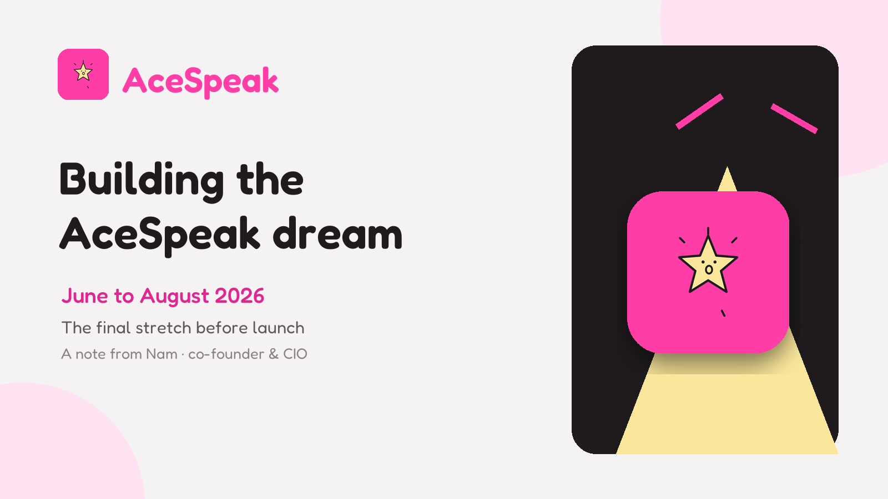
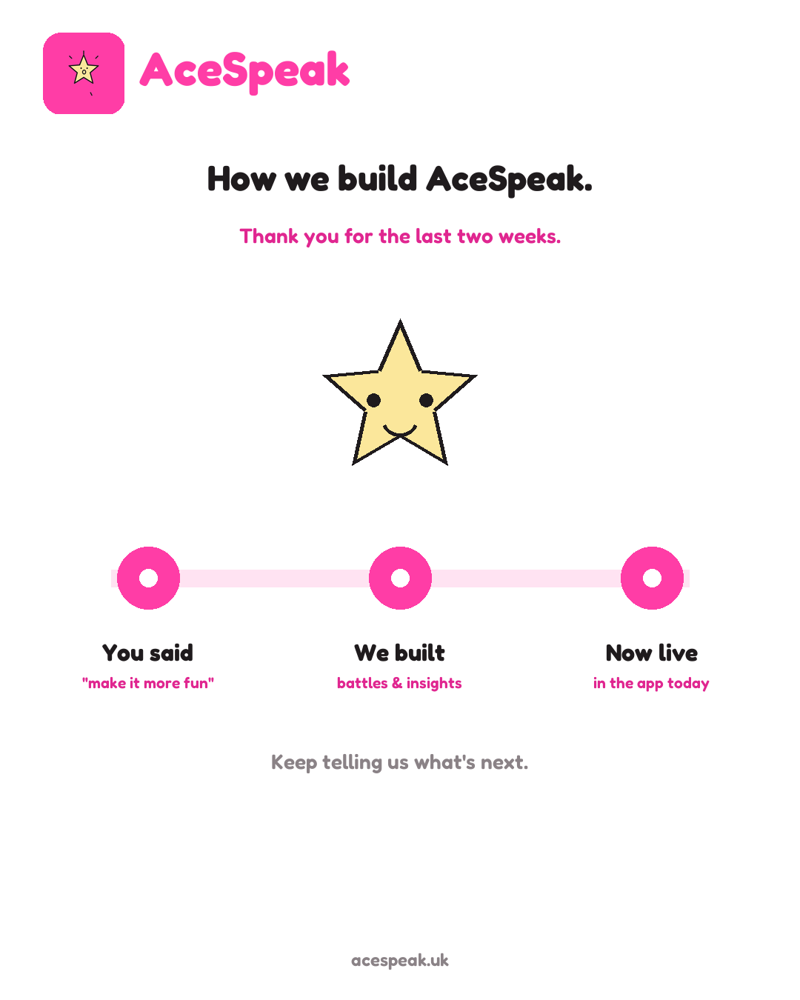
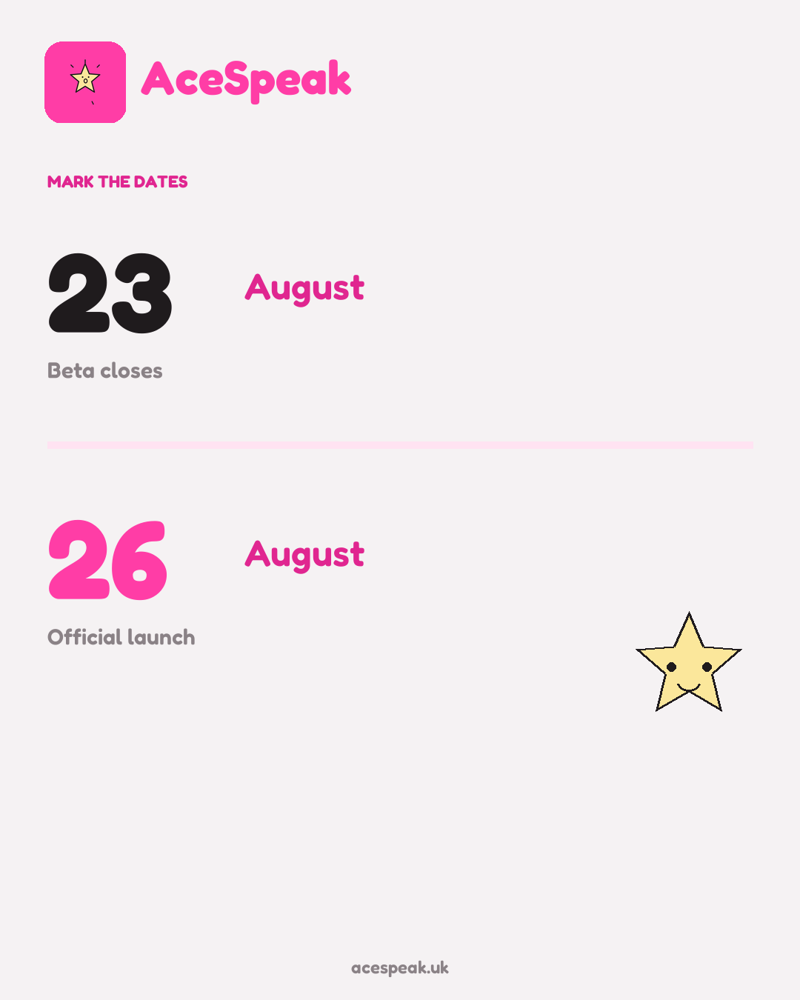

From June to August 2026, **AceSpeak became the work that followed us everywhere**.

It was there in the first thought of the morning and the last conversation at night. It was in every test take, every piece of beta feedback, every sentence we rewrote because it did not yet feel kind or clear enough, and every small decision that made the product feel a little more like the one we had imagined.

Now we are in the final stretch. Our official launch target is **26 August 2026**.

As **co-founder and CIO of AceSpeak**, I feel excited, proud, tired in the honest way, and deeply grateful. This is the first time I have written about AceSpeak on my personal website, and I want to record what these months have meant before launch day turns them into a neat story with a beginning and an ending.

The real version has been much messier—and much more meaningful.

## Table of contents

## The dream underneath the product

AceSpeak began with a belief that feels more important every month: **in the age of AI, speaking is what stays human**.

AI can help us find the words. It can reorganise an answer, sharpen a pitch, or help us prepare for a difficult conversation. But eventually we have to look up from the screen. We still have to walk into the interview, stand in front of the room, join the call, or tell another person what we believe.

Only we can do that part.

Our dream is to help people rediscover—and enjoy—the joy of speaking. Not simply to perform better in one important moment, but to build a healthier relationship with practice itself. We want another take to feel like an opportunity, not a punishment; a pause to feel like something to explore, not something to hide.

*The dream is bigger than a score: help people enjoy using a voice that remains unmistakably their own.*

That is the idea we carried into June. By August, it had to survive contact with a real product, real people and real feedback.

## Turning a belief into something people can use

AceSpeak is an AI interview and public-speaking coach. A person uploads a video take and receives a delivery score with specific, actionable guidance for the next one.

The product loop is deliberately simple: **see what happened, choose one useful change, and try again**.

Making that loop feel simple has not been simple work.

The difficult part was never adding as much as possible. It was deciding what deserved the person's attention next. Feedback had to be honest without becoming harsh, specific without becoming clinical, and encouraging without praising something that did not happen. The technology had to stay in the background so the speaker—not the system—remained the point.

These sound like writing decisions, design decisions and product decisions because they are all three. They are also trust decisions. Speaking is personal. When someone uploads a practice take, we have a responsibility to treat both the person and the information they share with care.

That responsibility is a large part of what the **CIO** role means to me. It is not only about systems and information moving correctly. It is about making sure the way we learn, decide and build remains aligned with the promise we made to the person using the product.

## June to August: build, listen, change, repeat

The last three months have had their own version of the AceSpeak loop.

We built. People tried it. They told us what felt useful, what felt confusing and what would make them want to practise again. Then we changed the product and put it back in their hands.

Two weeks of beta feedback, for example, helped shape a head-to-head battle mode, richer profiles and personalised 30-day insights. Those features matter, but the deeper lesson matters more: **the product became better when we stopped treating feedback as a final review and made it part of the build itself**.

*The beta was not a waiting room for launch. It became part of how we built.*

Working hard did not mean chasing motion for its own sake. It meant returning to small details until they carried the right intention. It meant testing the same journey again after a change that looked tiny on paper. It meant listening without defending the first version. It meant saying no to ideas that were exciting but did not make the next practice take clearer.

Some days the visible progress was a new capability. On other days, the win was one confusing sentence becoming understandable. Both kinds of work counted.

## The people who made the beta real

As of **8 August**, 146 people had joined the AceSpeak beta.

That number matters to me not because it looks impressive on a slide, but because every person represents trust. They gave an unfinished product their time. They uploaded takes, tried new ideas and told us the truth when something was not working.

Friends and family helped especially early, when the experience needed patience as much as feedback. Later testers brought fresh eyes and questions we had become too close to see. Together, they changed the product in ways our team could not have produced alone.

To everyone who tested, retested, sent a screenshot, explained a confusing moment or simply encouraged us: **thank you**. AceSpeak is more real because you treated it as something worth helping.

This is also why launch does not feel like a solo founder moment to me. A product may have co-founders, but it reaches reality through a much wider group of people who lend it attention before the rest of the world does.

## What being a co-founder and CIO means here

I have spent years as a CTO thinking about delivery: architecture, teams, risk, production systems and the decisions that keep them working.

AceSpeak asks me to bring that experience into a different kind of leadership. As co-founder and CIO, I have to connect the vision to the information we receive every day. What are people actually doing? Where are they getting stuck? Which signal should change the roadmap, and which one needs more context? Are we making the product more useful without making the person less visible?

I also have to protect the dream from becoming a slogan.

“Bring back the joy of speaking” only means something if it changes the details. It should affect the tone of a tip, the amount of information shown at once, the way progress is framed and whether the product invites another attempt. A vision earns its place when it helps a team decide what to build—and what not to build—on an ordinary Tuesday.

That is the work I am proud to share with this team.

## 26 August is a target, not a finish line

Our beta is scheduled to close on **23 August 2026**. Our official launch target is **26 August 2026**.

*Two dates we have been working towards: beta close on 23 August, official launch target on 26 August.*

I have imagined launch day many times. Of course I want to celebrate it. Our team has worked intensely for this moment, and the dream we have been carrying since June is close enough to touch.

But launch is not proof that the dream is complete. It is the day we invite more people into it.

There will be more feedback, more difficult choices and probably more things that behave differently in the real world than they did in our careful tests. That does not make the launch less exciting. It makes it honest. A startup becomes real not when the work ends, but when the work begins to matter to people beyond the team.

## What I want us to protect after launch

When the pace is high, it is useful to write down the things that should not be traded away:

- **The person remains the point.** AI should help someone become more present, not speak in their place.
- **One useful change beats a wall of judgement.** Practice becomes repeatable when the next step feels possible.
- **Kindness and honesty belong together.** Encouragement should be real, and correction should preserve dignity.
- **Listening is part of building.** Beta feedback shaped AceSpeak before launch; that habit must continue afterwards.
- **Joy is a product requirement.** If practice feels like punishment, we have missed the vision no matter how sophisticated the system is.

These principles are not launch copy. They are commitments I want us to be measured against.

## The dream is almost here

June feels both very recent and very far away. We began this stretch with a belief about the future of human expression. We are approaching the end of August with a product, a growing community of early testers and a date circled on the calendar.

I am proud to be AceSpeak's co-founder and CIO. I am proud of how hard our team has worked, and even prouder that the work has kept returning to something human.

AI will keep getting better at writing words. Our voices will still be ours to use.

That is the dream behind [AceSpeak](https://acespeak.uk). On 26 August, we hope to take its next real step.

---

*If you want to follow what we are building, visit [AceSpeak](https://acespeak.uk), [connect with me on LinkedIn](https://www.linkedin.com/in/nam-chan/), or [follow me on Medium](https://nam0403.medium.com/). I will keep sharing what launch teaches us after the celebration is over.*
