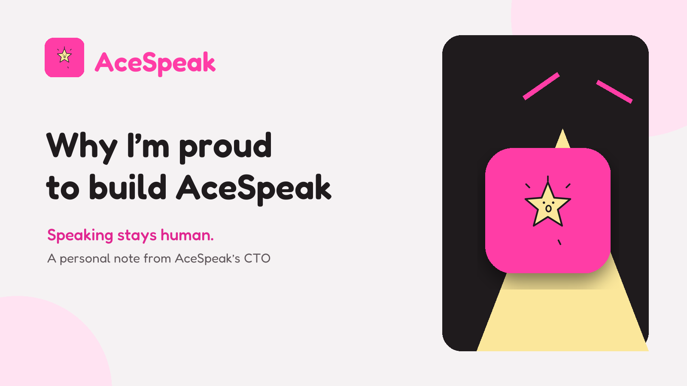
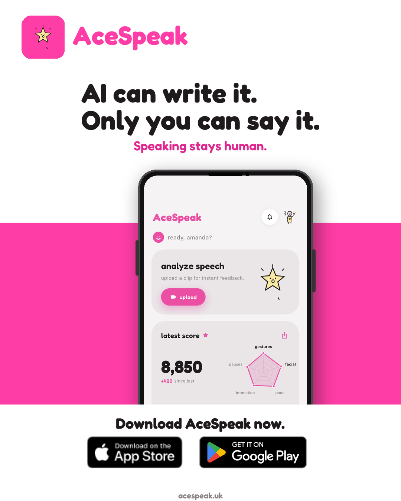
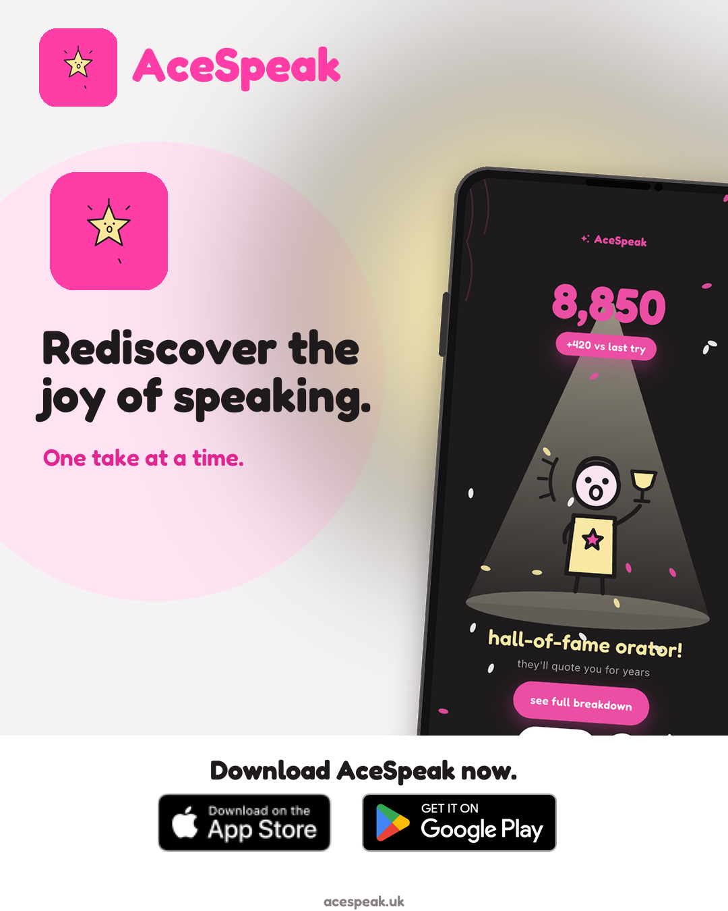

_Speaking stays human._

I have spent much of my career thinking about what technology can make possible. Today, I want to write about something more personal: **I am proud to be working as CTO of AceSpeak.**

I am not going to discuss how we build the product. This is not a technical deep dive, a launch note, or a list of features. It is about the reason AceSpeak deserves to exist—and why that reason matters so much to me.

## Table of contents

## The moment after AI has finished writing

AI can help us find words. It can suggest an opening, reorganise an argument, or turn a rough thought into a clearer answer.

Then comes the part it cannot do for us.

We still have to look up from the screen. We still have to enter the interview, stand in front of the room, join the call, or begin the conversation. We have to decide how to use our voice, when to pause, and whether to trust what we want to say.

That handover—from generated words to a human voice—is where AceSpeak begins.

This is what drew me to the project. It starts with a very modern reality, but it leads back to something ancient and deeply human: one person trying to communicate with another.

_AI can help with the words. Presence, expression and meaning still belong to the speaker._

## Our vision: bring back the joy of speaking

AceSpeak’s vision is to help people rediscover—and enjoy—the joy of speaking in the age of AI.

The word **joy** matters.

Speaking is often treated as a test. An interview feels like judgement. A presentation feels like exposure. A pitch feels like one chance to get everything right. When practice carries that same pressure, it is easy to avoid it until the moment arrives.

We want a different relationship with speaking: one built on curiosity, play and progress. Practice should feel like a place where trying again is normal. A pause should be something to explore, not a reason for embarrassment. A second take should feel like another chance, not evidence that the first one failed.

Joy does not mean that every speech is easy. It means the process can contain discovery. It means people can notice themselves improving. It means speaking can become something they want to return to, rather than something they only endure when necessary.

_The ambition is not simply better performance. It is a healthier and more enjoyable relationship with speaking._

## Our mission: make practice feel possible

A vision becomes useful only when it changes what a person can do next.

Our mission is to make speaking practice visible, specific and enjoyable enough to repeat. At its heart is a gentle loop: notice what happened, choose one useful change, and try again.

That may sound simple. I believe its simplicity is a strength.

People rarely need another voice telling them that everything was wrong. They need a clear place to begin. Progress becomes less intimidating when the next step is small enough to attempt and meaningful enough to notice.

That is the kind of practice experience I want AceSpeak to represent: encouraging without being vague, professional without being stiff, and playful without becoming childish. It should respect the seriousness of the moment someone is preparing for while making the preparation itself feel lighter.

It should also be kind. Speaking is personal. A product in this space should never make someone feel smaller in the name of helping them improve.

> [!important] The principle I want us to protect
> Technology should stay in the background. The person should feel more present, not less.

## Why I love this project

I love AceSpeak because its purpose is human before it is technological.

The project asks a question I care about: **can technology help people express more of themselves without taking their place?**

For me, the best answer is not a machine that speaks on someone’s behalf. It is a person who feels more ready to speak in their own voice.

I also love that progress here can be small and still matter. One calmer opening. One pause that gives an idea room to land. One more attempt made with less hesitation. These changes may look modest from the outside, but they can alter how someone enters an important moment.

I love the balance we are trying to hold. AceSpeak should be credible enough for interviews, presentations and pitches, yet joyful enough that practice does not feel like punishment. Professional and playful are not opposites when both serve the learner.

Most of all, I love that the project refuses a bleak version of the AI future. As machines become better at producing language, human expression does not become less valuable. It becomes more important. The words may be polished by software, but courage, timing, humour, warmth and conviction still arrive through a person.

That is worth building for.

## What being CTO means to me

Being CTO is usually described through systems, decisions and delivery. Those responsibilities matter, but they are not the part I want to celebrate here.

For me, this role also means protecting the intention behind the product.

It means asking whether each decision brings us closer to the experience we promised. Does this make practice clearer? Does it encourage another useful attempt? Does it preserve dignity? Does it leave the speaker feeling that the achievement belongs to them?

Those questions are not technical details. They are the reason the details matter at all.

I am proud to work on a project where success is not defined by making the human disappear. It is defined by helping the human step forward.

## The future I hope we help create

I hope AceSpeak becomes part of a world where practising your voice feels as normal as editing your words.

I hope a job seeker can enter an interview feeling that their ideas have room to be heard. I hope a founder can approach a pitch with curiosity instead of dread. I hope someone preparing a presentation can see another take as progress rather than punishment.

And I hope that, in an age full of generated language, more people rediscover the pleasure of saying something in a way that is unmistakably their own.

That is AceSpeak’s vision. It is our mission. And it is why I am so proud to be building it.

_If that vision resonates with you, you can learn more about [AceSpeak](https://acespeak.uk)—and, more importantly, keep practising the voice that only you can bring._

---

_For more practical notes on AI, products and the human decisions behind them, [follow me on Medium](https://nam0403.medium.com/), [subscribe or bookmark nam-ai.uk](https://nam-ai.uk), or [connect with me on LinkedIn](https://www.linkedin.com/in/nam-chan/)—I am always interested in what technology helps people become._
