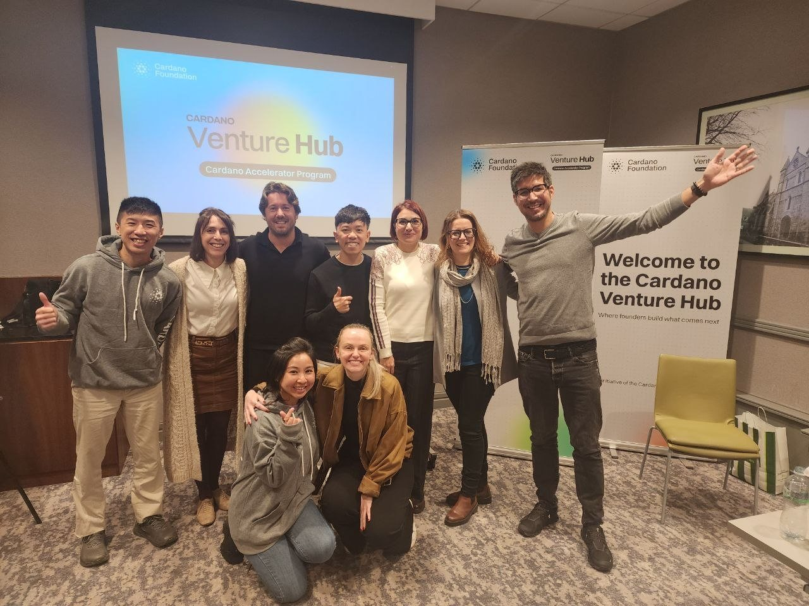
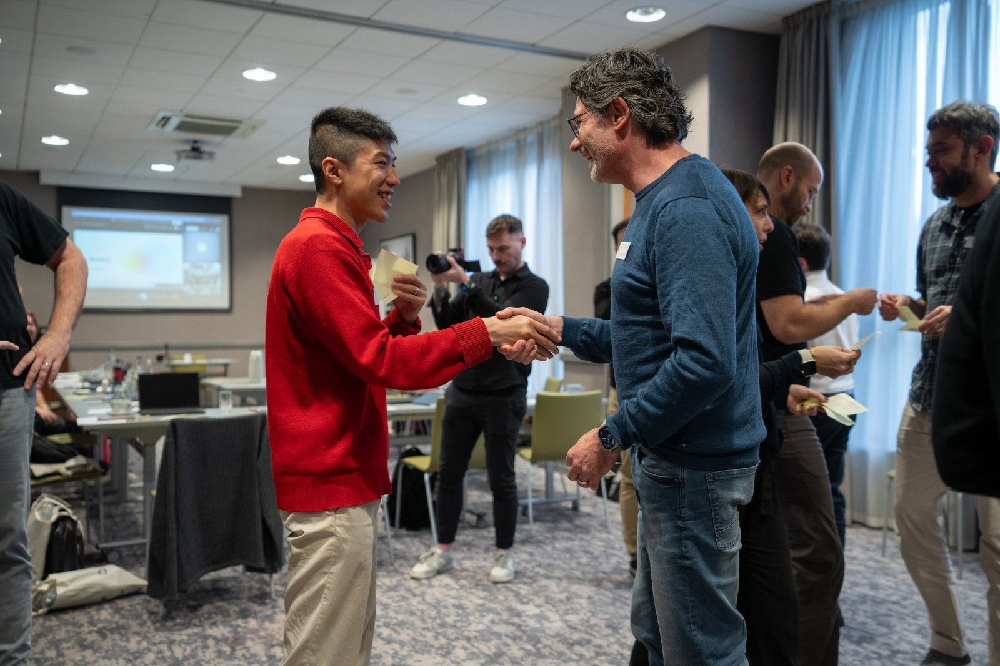
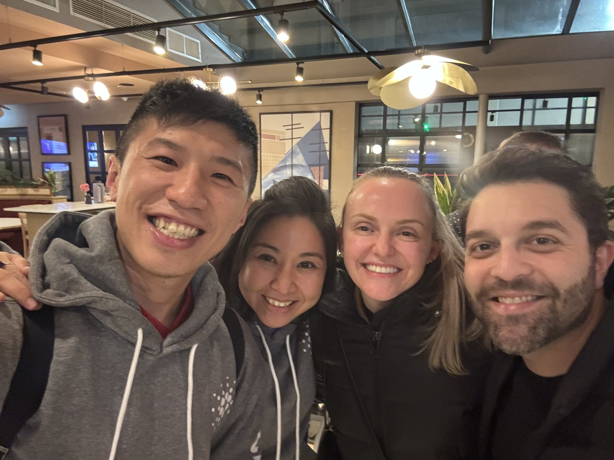
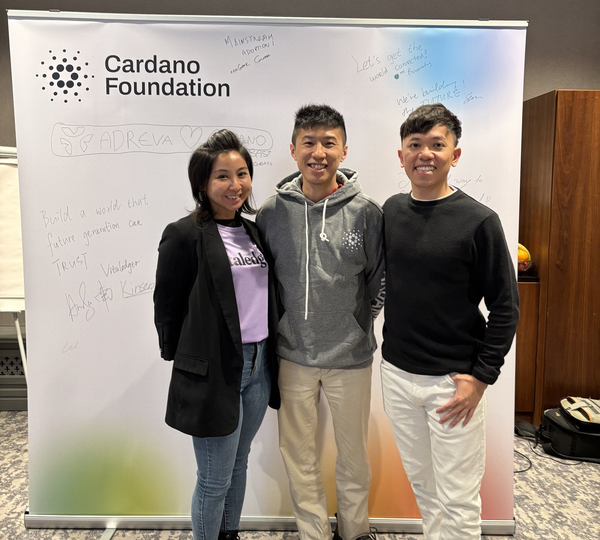

*啟動週最後一個下午，在都柏林的 Cardano Venture Hub。*

離開都柏林之前，VitaLedger 團隊用白板筆在 Cardano 基金會的留言牆上寫下一句：

> Build a world that future generation can trust.
>
> 建立一個下一代可以信任的世界。

這是一句很大的話，而我們離它還很遠。圍繞著它的三天，大部分時間都在認清：由這句話到下一小步之間，原來還有這麼多功夫要做。

11 月 3 日至 5 日，我和 VitaLedger 團隊在都柏林參加 Cardano 基金會 Cardano Accelerator Program 的啟動週。能夠成為這一屆八支團隊之一，我們很感恩。出發前我提醒自己，要多聽少講，事後證明這是對的。

這篇是我那一週的筆記：從其他創辦人身上學到的事、我們正在做的事，以及我帶回來的幾點體會。

## 目錄

## 八支團隊，同一條問題

這一屆梯隊是圍繞一條問題聚在一起的，用基金會的說法：*一個關於產品、數據集或紀錄的說法，怎樣才站得住腳？*

其他團隊切入這條問題的角度，很多是我之前沒有想過的：

- **Embeddo**：用邊緣 AI 在排放源頭量度車輛的二氧化碳，並把紀錄錨定在 Cardano 上。
- **Booomtag**：透過在工廠已內置的 NFC 或 QR 標籤，為實體產品提供數碼產品護照（Digital Product Passport）。
- **Forg3t Protocol**：建立一套讓 AI「遺忘」特定資訊、並能證明已經遺忘的方法。
- **Adreva**：建立由用戶擁有、以私隱優先的個人檔案層，用於個人化廣告。
- **Palmyra**：由頭到尾追蹤大宗商品的供應鏈。
- **Open Food Chain**：把證書和供應商資料變成可掃描的產品護照，每一個說法都連結到它的證據。
- **AgrowLabs**：追蹤受監管農產品的批次，讓監管機構可以自行核實整條保管鏈。
- 還有 **VitaLedger**，即是我們，處理的是家庭所得到的食物資訊背後的證據。

排放、產品護照、AI 遺忘、廣告、大宗商品、食物、農業。紙面上，這些公司沒有甚麼共通點。但我一直留意到，底下的問題是一樣的：誰有資格作出這個說法？有甚麼證據支持？說法改變了又怎樣？公司以外的人，怎樣在不用單憑公司一句話的情況下，自己去核實？

我本來就預期會從 CAP 團隊和導師身上學到很多，事實也是如此。我沒有預料到的，是從其他創辦人身上學到的同樣多。產品不同、市場不同，卻有很多相同的難題，而每支團隊切入的方式，都讓我學到一些東西。

*在其中一個梯隊活動裡交換紙卡、握手認識。*

## 我們正在做的事

VitaLedger 是 [VitaBaby](https://vitababy.ai) app 背後的公司。VitaBaby 用 AI 幫助家長理解給孩子吃的食物；而在 app 底下，我們嘗試借助 Cardano，令這些資訊背後的證據可以讓人自己去核實。家長不需要懂任何區塊鏈知識，也應該可以受惠。

去都柏林之前，我花了些時間，確保自己可以用淺白的說話解釋我們的做法。對我幫助最大的一個比喻是：**把紀錄放上區塊鏈，是郵戳，不是批核印章。** 它可以顯示一條紀錄在甚麼時候已經存在、由誰發布，以及之後沒有被改動過，但不能證明紀錄的內容是對的，我們也盡力不作任何相反的暗示。

> [!important] 重要：我們實際上走到哪一步
> 我們仍在起步階段。手上的仍然是一個在測試網絡上的試點，不是完成品。贏得第一批真正的品牌和化驗所的信任，是我們接下來要做的事。

和一班同樣做驗證的人相處了三天，令我更想小心衡量我們說出口的每一句。如果說有甚麼改變，就是這一週令我們對自己的描述變得更小、更準確。

## 由一份 pitch 到一份計劃

基金會為這一週的總結，是八家初創「三天之內，由最初的 pitch 走到一份十週的路線圖」（[Cardano Foundation 在 X 的帖文](https://x.com/Cardano_CF/status/2118396938177716441)）。這和我的感受一樣。我們帶著一份 pitch deck 去，在導師的幫助下，帶著一份寫明負責人和日期的計劃回來。

我們的計劃說起來簡單，做起來仍然不容易：

- **與導師一起檢視我們的設計**，再根據他們的意見收緊。
- **與真正的品牌、化驗所和認證機構進行小規模試點**，前提是我們能贏得他們的信任。
- **把學到的東西帶到 Demo Day**，再誠實地決定下一步。

制定這份計劃時學到的一課，我仍在消化：**只把硬指標放在取決於自己努力的事情上**，例如打了多少個電話、推出了多少個版本、發表了多少份報告。凡是取決於別人點頭的事，例如有發布者願意加入，與其寫成一個假裝自己控制得到的日期，不如寫成「第一個」里程碑或決策點。這樣的計劃讀起來沒那麼刺激，但更誠實。

## 環節與環節之間的人

白天是工作坊，晚上是團體晚餐，而不少最好的對話，都發生在兩者之間。我回來時帶著的問題，比出發時多得多。

*不少最好的對話，都發生在環節與環節之間。*

那幅留言牆說的也是同一個故事。在我們那一句的周圍，其他團隊寫下了自己的話：「Mainstream adoption!」、「Let's get the world connected!」、「We're building the future!」，還有手畫的「Adreva ♡ Cardano」。八家公司，好多種筆跡，同一幅牆。

*與 VitaLedger 團隊在 Cardano 基金會留言牆前。左邊就是我們那一句：「Build a world that future generation can trust.」*

## 我帶回來的幾點體會

- **可驗證性正在變成大家預期的事，而不是可有可無。** 基金會為這一屆梯隊定下的框架是：證明一樣東西從哪裡來、一條紀錄是真確的，已經「由錦上添花，變成商業和監管上的要求」。認識了另外七支面對同一個問題的團隊之後，我對這句話的感受真實得多。
- **證明證明了甚麼，就說甚麼，不多說。** 是郵戳，不是批核印章。
- **讓技術退到幕後。** 家長應該可以核實一條紀錄，而不需要先學懂區塊鏈。
- **只承諾自己控制得到的事。** 自己的努力用數字衡量，其他的用決策點處理。
- **好好聽其他創辦人說話。** 我低估了可以從他們身上學到多少。下一次，我會為這些對話留更多時間。

## 多謝

多謝 Cardano 基金會和 CAP 團隊帶來一個很有啟發的星期，也多謝在都柏林認識的每一位創辦人，這麼坦誠地分享。在 2 月 3 日 Demo Day 之前，我們還有很多功夫要做，會盡力不辜負大家付出的時間。

如果你經營食品品牌、化驗所或認證機構，願意和我們一起試試；又或者你也在 Cardano 上做產品，想交流一下，我很樂意[聽聽你的想法](mailto:nam@wistkey.com)。

---

*往 Demo Day 的路上，我會繼續分享我們學到的事，包括不如預期的部分。歡迎[在 Medium 追蹤我](https://nam0403.medium.com/)、[訂閱或收藏 nam-ai.uk](https://nam-ai.uk)，或者[在 LinkedIn 連繫我](https://www.linkedin.com/in/nam-chan/)，一路跟進。*
