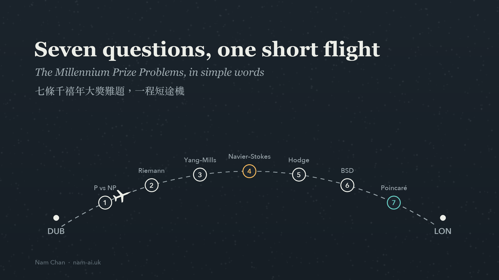
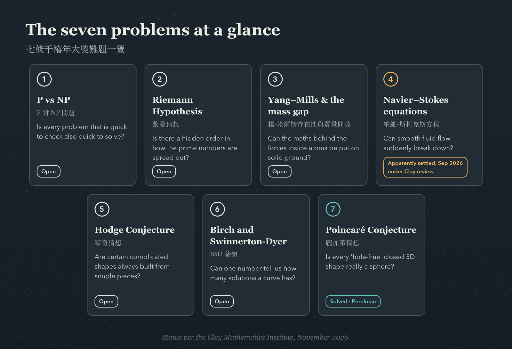
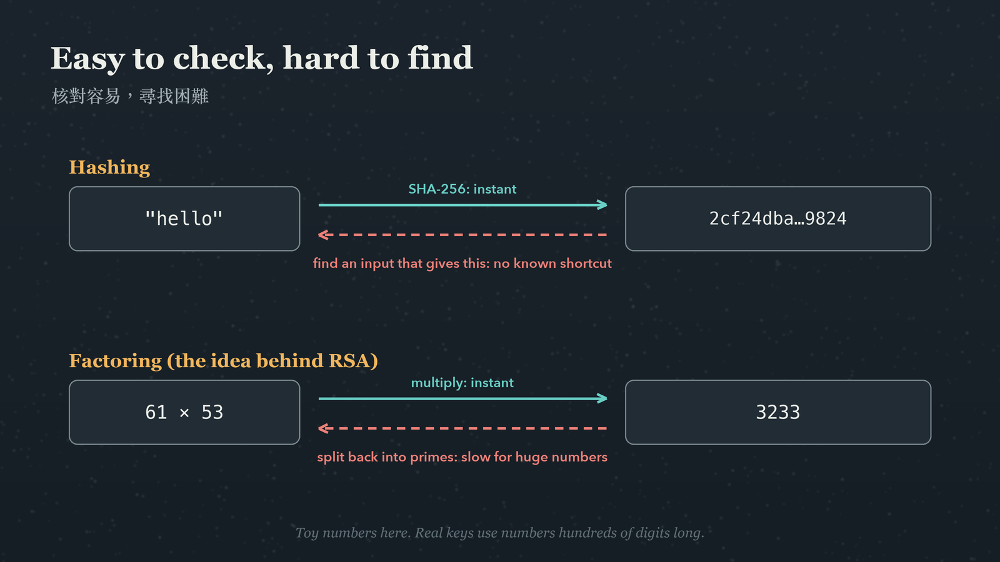
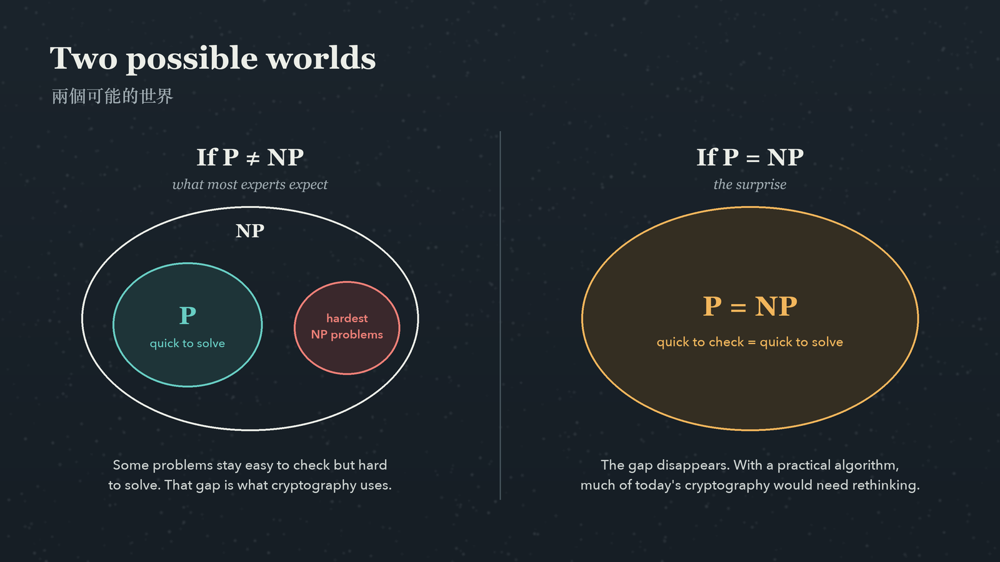

由都柏林飛回倫敦，航程只是一個多小時，剛好夠喝一杯咖啡。在 [Cardano Accelerator Program 啟動週](https://nam-ai.uk/zh/posts/cardano-accelerator-program-dublin/)忙了一整個星期，腦袋已經塞滿，實在不想再看電郵。於是我做了一件很久沒做的事：純粹為了興趣，讀讀數學。

我讀的是數學與資訊工程雙學位，而七條**千禧年大獎難題（Millennium Prize Problems）**一直都很吸引我。2000 年，克雷數學研究所（Clay Mathematics Institute）選出七條數學界最難的未解問題，每解決一條，獎金一百萬美元（[克雷數學研究所](https://www.claymath.org/millennium-problems/)）。

這是一篇簡單的文章：每條難題用幾句淺白的說話介紹，再花多一點篇幅，講講飛機降落倫敦時我一直在想的那一條：**P 對 NP 問題**。原因是它就在現代科技所依賴的加密和雜湊（hash）技術底下。

> [!note] 備註：簡單，但不精確
> 為了易讀，我把每條難題都簡化了，與嚴格的數學表述會有些出入。想看正式版本，可以參考克雷研究所的[官方難題頁面](https://www.claymath.org/millennium-problems/)。

## 目錄

## 七條難題一覽



*五條仍然未解，一條在二十多年前已經解決，還有一條在今年秋天「看來已經解決」。*

## 七條難題，用簡單的說話講

### 1. P 對 NP 問題

如果一個答案很容易核對，是否代表它也一定很容易找出來？想想數獨：核對一個填好的格子只需一分鐘，但從零開始解一題難的數獨，可能要花上長得多的時間。P 對 NP 問題問的是：這個差距是真實存在的，還是每一條「容易核對」的問題，其實都暗藏一個很快的解法？大部分電腦科學家相信差距是真的，但沒有人能證明。下面會再詳細談這一條。

### 2. 黎曼猜想

質數（2、3、5、7、11……）看起來分佈得近乎隨機，但平均來說，它們變得稀疏的方式出奇地有規律。1859 年，黎曼把質數的分佈規律和一個特別的函數（今天稱為 zeta 函數）連繫起來，並猜想它所有重要的零點都落在同一條直線上。如果他是對的，我們對質數分佈的了解會精確得多。數學上有很多結果，都是在「假設黎曼猜想成立」的前提下證明的，至今仍在等它。

### 3. 楊-米爾斯存在性與質量間隙

物理學家用楊-米爾斯理論描述原子內部的作用力，它和實驗結果吻合得非常好。缺少的是數學：沒有人證明這套理論能建立在完全嚴謹的基礎上，也沒有人證明「質量間隙」，即理論所預測最輕的粒子，質量一定大於零。實驗和電腦模擬都顯示確實如此，但證明仍然欠奉。

### 4. 納維-斯托克斯方程

這組方程描述流體怎樣流動：水管裡的水、天氣、機翼上的氣流。我讀到這一條時，正好坐在它的實際應用裡面。問題是：在三維空間裡，一開始流動平順的流體，是否永遠保持平順？還是它的運動會突然崩潰，速度在有限時間內衝向無限大？

這一條有新消息。2026 年 9 月，OpenAI 宣布其內部一個 AI 系統證明了這組方程**確實可以**崩潰：一團起初靜止、並受到平滑外力作用的流體，可以在有限時間內出現奇點。這個證明亦已在 Lean 證明輔助工具中由電腦核對（[OpenAI](https://openai.com/index/navier-stokes-solution/)）。克雷研究所表示這條問題「看來已經解決」，但尚未頒發獎項，並形容其評審過程是「刻意不急」的（[克雷研究所公告](https://www.claymath.org/news/navier-stokes-announcement/)）。OpenAI 則表示無意申領獎金。

### 5. 霍奇猜想

這大概是最難簡單解釋的一條。數學家用一些可以偵測特徵的工具，去研究多維空間裡的複雜形狀，有點像照 X 光。其中有些形狀，也可以用多項式方程來描述。霍奇猜想說：對這類形狀來說，X 光照到的某一類特徵，總是可以由一些本身也用方程描述的簡單部件砌出來。粗略地說，就是複雜的結構，總是由簡單、清楚明白的積木組成。

### 6. 貝赫和斯維納通-戴爾猜想（BSD 猜想）

這一條關於橢圓曲線，即類似 y² = x³ − x + 1 的方程。一個很自然的問題是：這條方程有無限多個分數解，還是只有寥寥幾個？這個猜想說，只要看一個相關函數在某一點的表現，就可以知道答案。橢圓曲線並不只是抽象的東西。同一類曲線放在另一種數字系統裡運算，就是橢圓曲線密碼學的基礎，保護著今天互聯網上很大部分的流量。

### 7. 龐加萊猜想（已解決）

想像一個封閉、沒有邊緣的三維形狀，在上面任何一個繩圈都可以收緊成一點，而不會被卡住。它是否一定就是一個（三維版本的）球面？龐加萊在 1904 年提出這個問題。佩雷爾曼在 2002 和 2003 年於網上發表的論文中證明了它，建基於漢密爾頓的里奇流理論。克雷研究所在 2010 年向他頒發獎項，而他拒絕了。

## 我一直在想的那一條：P 對 NP 問題

七條之中，P 對 NP 問題和我的日常工作最接近。

用電腦科學的說法，**P** 是電腦可以很快解決的問題的集合，**NP** 是「給你一個答案，可以很快核對對不對」的問題的集合。「很快」有精確的定義：所需時間隨輸入大小以多項式增長，而不是以指數爆炸。凡是可以很快解決的，自然也可以很快核對，所以 P 包含在 NP 之內。問題是：兩者其實是否一樣？

這件事的重要性不止於數學。現代保安有很大一部分，是建立在一些（就我們所知）單向容易、反向困難的問題之上。

**雜湊。** 雜湊函數把任何輸入變成一個長度固定的短「指紋」。順向計算是即時的：

```bash
printf 'hello' | shasum -a 256
# 2cf24dba5fb0a30e26e83b2ac5b9e29e1b161e5c1fa7425e73043362938b9824  -
```

在 Linux 上，用 `sha256sum` 效果一樣。反過來，要找出一個能產生指定指紋的輸入，就沒有已知的捷徑。但如果有人給你一個候選輸入，核對只需要一行指令。核對容易、尋找困難，正正就是 NP 問題的模樣。密碼儲存、檔案完整性檢查和區塊鏈，都依賴這一點。

**加密和數碼簽署。** RSA 是經典的公開密鑰系統之一，它依賴的事實是：把兩個很大的質數相乘很容易，但要把乘積拆回原本的質數就非常困難。而核對一個候選答案，只需要做一次乘法。



*現代保安很多都建基於這個模式：順向很快，反向（我們相信）很慢。*

那麼，如果 P = NP 又會怎樣？如果有人用一個實用的演算法證明了它，困難的方向就不再困難。找出雜湊的輸入、或者還原私鑰，會變得和核對一樣容易，今天的密碼學有很大部分都要重新思考。不過，同一個突破亦會令大量排程、物流和最佳化問題一夜之間變得容易，所以也不全是壞消息。



*大部分專家預期是左邊的世界，但沒有人證明過。*

為免說得太誇張，有三點我要提醒自己：

- **P ≠ NP 不會自動令密碼學變得安全。** P 對 NP 問題講的是最壞情況，而密碼學需要的是在我們實際使用的一般情況下都困難的問題。因數分解甚至未被證明是 NP 裡最難的問題之一。即使證明了 P ≠ NP，也只是令人安心，而不是保證。
- **P = NP 未必實用。** 一個演算法在技術定義上可以算是「很快」，但實際上仍然慢得無法運行，例如所需時間隨輸入大小的 100 次方增長。
- **量子電腦是另一個威脅。** 只要量子電腦夠大，秀爾演算法（Shor's algorithm）就可以破解 RSA 和橢圓曲線密碼學，與 P 對 NP 問題的答案無關。這正是美國國家標準與技術研究院（NIST）在 2024 年 8 月發布首批後量子密碼學標準的原因（[NIST](https://csrc.nist.gov/news/2024/postquantum-cryptography-fips-approved)）。

## 降落倫敦

飛機降落倫敦時，我腦海裡一直轉著的，是現代科技有多少部分，建立在一件沒有人證明過的事情上。每一個安全的網站、每一個儲存起來的密碼、區塊鏈上的每一個簽署，都默默假設「核對容易、尋找困難」是真的。我們有充分理由信心十足地依賴這個假設，但在數學上，它仍然是一條未解的問題。

納維-斯托克斯的消息，也一直留在我心裡。根據 OpenAI 的說法，大約一萬個 AI agent 合作了不到四天，就找到了人類花了幾十年都未找到的東西，而且結果附有可以由電腦核對的證明。某程度上，這正是 NP 的精神：尋找的過程極其龐大，但核對可以交給機器。這令人興奮，但老實說，AI 能力進步得這麼快，也令我有點不安。能夠核實這些系統產出的東西，比以往任何時候都重要。

如果你也對數學有一份偏愛，或者正在思考後量子密碼學對你的系統有甚麼影響，很歡迎[和我聊聊](mailto:nam@wistkey.com)。

---

*多謝你讀這篇和平時有點不同的文章。歡迎[在 Medium 追蹤我](https://nam0403.medium.com/)、[訂閱或收藏 nam-ai.uk](https://nam-ai.uk) 等下一篇，亦歡迎[在 LinkedIn 連繫我](https://www.linkedin.com/in/nam-chan/)。*
