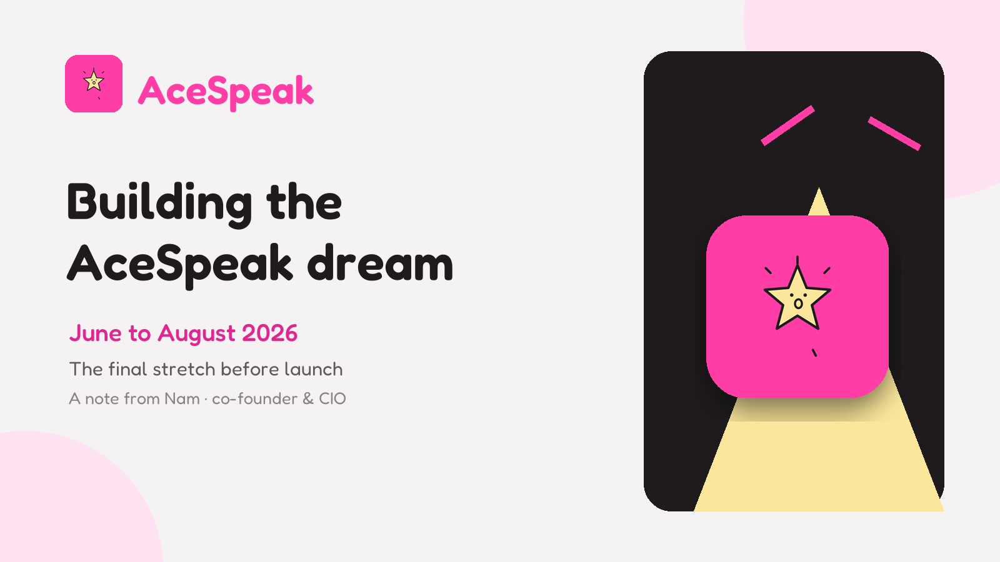
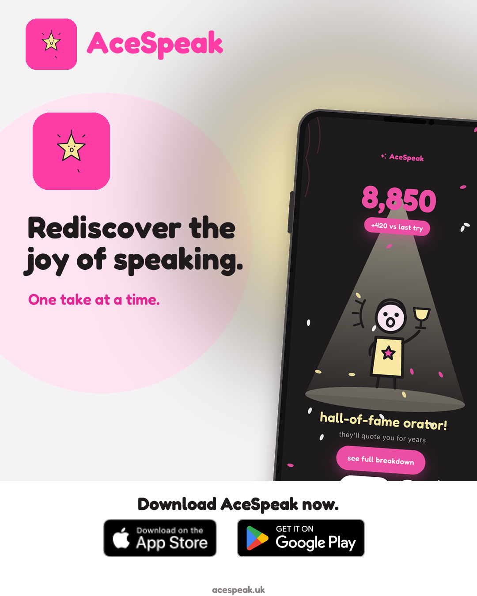
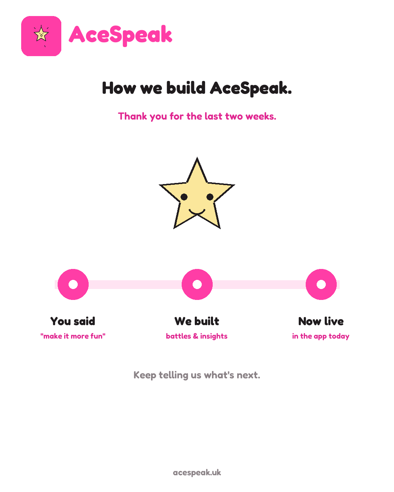
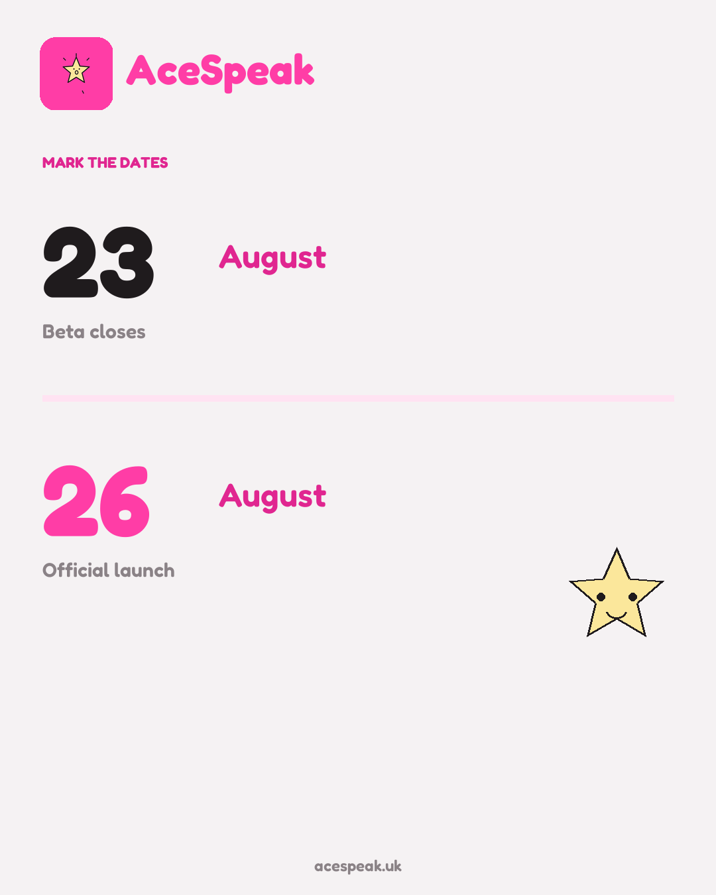

2026 年 6 月到 8 月，**AceSpeak 成為一份無時無刻都跟著我們的工作**。

早上醒來的第一個念頭、晚上結束前的最後一場對話，都離不開它。每一次測試、每一則 beta 回饋、每一句因為還不夠友善或清楚而重新修改的文字，以及每一個讓產品更接近最初想像的小決定，都在把它往前推進。

現在，我們來到最後階段。AceSpeak 正式上線的目標日期是 **2026 年 8 月 26 日**。

身為 AceSpeak 的**共同創辦人兼 CIO**，我現在的感受是興奮、自豪、帶著一種誠實的疲憊，也充滿感激。這是我第一次在個人網站寫 AceSpeak。我想在上線日把這幾個月整理成一個有開頭、有結尾的故事以前，先記錄它真正代表的意義。

真實的版本混亂得多，卻也有意義得多。

## 目錄

## 產品背後的夢想

AceSpeak 始於一個每個月都顯得更重要的信念：**在 AI 時代，說話仍然是屬於人的事**。

AI 可以幫助我們找到合適的文字、重新整理答案、改善提案，或準備一場困難的對話。但我們最後仍然要把目光離開螢幕，親自走進面試、站到房間前面、加入通話，並告訴另一個人自己真正相信什麼。

這個部分，只有我們自己能完成。

我們的夢想，是幫助人們重新找回並享受說話的樂趣。不只是讓某一次重要場合的表現變好，而是建立一段更健康的練習關係。我們希望「再試一次」代表新的機會，而不是懲罰；希望一次停頓是值得探索的訊號，而不是必須掩飾的錯誤。

*夢想不只是一個分數，而是幫助每個人享受那個只有自己能表達的聲音。*

這是我們在 6 月帶進產品的想法。到了 8 月，它必須接受真正產品、真正使用者與真正回饋的考驗。

## 把信念變成真正可以使用的產品

AceSpeak 是一位 AI 面試與公開演說教練。使用者上傳一段練習影片後，可以獲得表達分數，以及下一次練習可以採取的具體建議。

產品的核心循環刻意保持簡單：**看見剛才發生了什麼、選擇一個有用的改變，然後再試一次**。

但是，要讓這個循環感覺簡單，背後的工作一點也不簡單。

最困難的部分從來不是加入最多功能，而是決定使用者下一步真正值得注意什麼。回饋必須誠實，但不能苛刻；必須具體，但不能像冰冷的診斷；必須鼓勵人，卻不能稱讚一件根本沒有發生的事。技術應該留在背景，讓說話的人——而不是系統——始終成為重點。

這些同時是文字、設計與產品決定，也都是關於信任的決定。說話是一件很私人的事。當一個人上傳練習影片，我們有責任謹慎對待那個人，以及他所分享的資料。

這份責任正是 **CIO** 角色對我的重要意義。它不只關於系統與資訊能否正確流動，也關於我們學習、決策與建造產品的方式，是否仍然符合對使用者許下的承諾。

## 6 月到 8 月：建造、聆聽、改變、重來

過去三個月，也有一套屬於 AceSpeak 團隊自己的循環。

我們先做出來，讓人們實際使用。他們告訴我們哪些地方有幫助、哪些地方令人困惑，以及什麼會讓他們願意再練一次。然後，我們修改產品，再交回他們手上。

例如，兩週的 beta 回饋協助我們做出雙人挑戰模式、更完整的個人檔案，以及個人化的 30 天洞察。這些功能很重要，但更深的體會是：**當我們不再把回饋當成最後的驗收，而是直接讓它成為建造過程的一部分，產品才真正變得更好**。

*Beta 不是等待正式上線的候車室，而是我們建造產品的一部分。*

努力工作不代表只追求忙碌的感覺，而是反覆處理小細節，直到它們能傳達正確的意圖。有時，一個在文件上看來很小的變更，也需要重新測試整段體驗。我們必須練習在聽到意見時不急著為第一版辯護，也必須拒絕一些很吸引人、卻無法讓下一次練習更清楚的想法。

有些日子的進步，是一項看得見的新功能；另一些日子的成果，只是把一句令人困惑的文字改得容易理解。兩種工作都同樣重要。

## 讓 beta 成為現實的人

截至 **8 月 8 日**，AceSpeak beta 已經有 146 人加入。

這個數字的重要性，不在於它放在簡報上是否亮眼，而在於每一個人都代表一份信任。他們願意把時間交給一個還沒完成的產品，上傳練習、嘗試新想法，並在某些地方不夠好的時候坦白告訴我們。

朋友與家人在最早期尤其重要。當時的體驗不只需要回饋，也需要耐心。後來加入的測試者帶來全新的眼光，提出一些我們因為太熟悉產品而看不見的問題。大家一起改變了 AceSpeak，這些改變不是團隊關起門就能完成的。

謝謝每一位測試、重試、傳送截圖、解釋困惑時刻，或只是在旁鼓勵我們的人。**因為你們願意把 AceSpeak 當成值得幫助的產品，它才真正變得更完整。**

因此，正式上線對我來說也不是一個只屬於創辦人的時刻。產品或許有共同創辦人，但它之所以能走進現實，是因為有更多人在世界看見它以前，先願意把注意力借給它。

## 在這裡，共同創辦人兼 CIO 代表什麼

多年來，我以 CTO 身分思考的重點一直是交付：架構、團隊、風險、正式環境，以及讓系統穩定運作的每一個決定。

AceSpeak 需要我把這些經驗帶進另一種領導工作。身為共同創辦人兼 CIO，我必須把願景與每天收到的資訊連接起來。人們實際上怎麼使用產品？他們在哪裡停下來？哪些訊號應該改變產品方向，哪些需要更多背景才能理解？我們能不能讓產品更有用，同時不讓使用者變得更不重要？

我也必須保護這個夢想，不讓它只剩下一句口號。

「重新找回說話的樂趣」只有在它真的改變細節時才有意義。它應該影響一則建議的語氣、一次呈現多少資訊、如何描述進步，以及產品是否讓人願意再試一次。只有當願景能幫助團隊在一個普通的星期二決定該做什麼、又不該做什麼，它才真正有價值。

我很自豪，可以和這個團隊一起做這份工作。

## 8 月 26 日是目標，不是終點

我們預計在 **2026 年 8 月 23 日**結束 beta，並以 **2026 年 8 月 26 日**為正式上線目標。

*我們一直努力前進的兩個日期：8 月 23 日結束 beta，8 月 26 日正式上線。*

我想像過很多次正式上線的那一天。當然，我很想好好慶祝。團隊為這個時刻投入了大量心力，而我們從 6 月一路帶著走的夢想，如今已經近得幾乎伸手可及。

但正式上線並不代表夢想已經完成，而是我們邀請更多人參與的那一天。

接下來一定還會有更多回饋、更多困難的選擇，也很可能有一些事情在真實世界中的表現，和仔細測試時不一樣。這不會減少上線的興奮，反而讓它更誠實。新創公司真正成形的時刻，不是工作終於結束，而是這些工作開始對團隊以外的人產生意義。

## 上線之後，我希望我們繼續守住的事

節奏很快的時候，更應該把不能交換掉的原則寫下來：

- **人始終是重點。** AI 應該幫助一個人更有存在感，而不是代替他說話。
- **一個有用的改變，勝過一整面批判。** 當下一步真的做得到，練習才可能不斷重複。
- **善意與誠實必須同時存在。** 鼓勵應該真實，修正也應該保留尊嚴。
- **聆聽本來就是建造的一部分。** Beta 回饋在上線前改變了 AceSpeak；這個習慣在上線後也必須繼續。
- **樂趣是一項產品需求。** 如果練習感覺像懲罰，無論系統多麼先進，我們都沒有實現願景。

這些不是上線宣傳文案，而是我希望大家未來用來衡量我們的承諾。

## 夢想即將成真

6 月感覺既像剛剛才發生，也像已經過了很久。我們帶著一個關於人類表達未來的信念開始這段旅程；現在，我們正帶著一個真正的產品、一群持續成長的早期測試者，以及行事曆上圈起來的日期走向 8 月底。

我很自豪能成為 AceSpeak 的共同創辦人兼 CIO。我為團隊投入的努力感到自豪，更為這些工作始終回到人的需要而自豪。

AI 會繼續變得更擅長寫出文字，但我們的聲音仍然屬於自己。

這就是 [AceSpeak](https://acespeak.uk) 背後的夢想。我們希望在 8 月 26 日，踏出它下一個真正的步伐。

---

*如果你想繼續關注我們正在建造的產品，歡迎瀏覽 [AceSpeak](https://acespeak.uk)、[在 LinkedIn 與我連繫](https://www.linkedin.com/in/nam-chan/)，或[在 Medium 追蹤我](https://nam0403.medium.com/)。慶祝過後，我也會繼續分享正式上線帶給我們的學習。*
